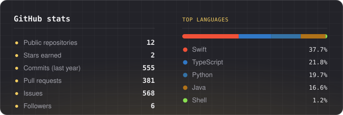

<h1 align="center">Hi, I'm David 👋</h1>

  <b>Full Stack Developer</b> · Computer Engineering student @ ESIC University 
  Building projects and exploring <b>software development, cloud, data and AI</b>.

## 👨‍💻 About Me

- 💻 Full Stack Developer focused on building modern applications, based in **Madrid, Spain** 📍
- 🎓 **Computer Engineering at ESIC University** · Higher Technician in **Cross-Platform Application Development (DAM)**
- 🏢 Professional experience with **SAP ABAP, SAP HANA, OpenSQL and ChaRM**
- 🚀 Building new side projects and exploring **cloud, data, AI and automation**

## ⚙️ Tech Stack

<table align="center">
  <tr>
    <td align="right" nowrap><b>Frontend</b></td>
    <td></td>
  </tr>
  <tr>
    <td align="right" nowrap><b>Backend</b></td>
    <td></td>
  </tr>
  <tr>
    <td align="right" nowrap><b>Cloud &amp; DevOps</b></td>
    <td></td>
  </tr>
  <tr>
    <td align="right" nowrap><b>Enterprise</b></td>
    <td>&nbsp;SAP ABAP · HANA&nbsp;&nbsp;&nbsp;&nbsp;OpenSQL&nbsp;&nbsp;&nbsp;&nbsp;ChaRM</td>
  </tr>
  <tr>
    <td align="right" nowrap><b>Data &amp; AI</b></td>
    <td>&nbsp;&nbsp;&nbsp;&nbsp;Pandas&nbsp;&nbsp;&nbsp;&nbsp;Power BI&nbsp;&nbsp;&nbsp;&nbsp;Vertex AI&nbsp;&nbsp;&nbsp;&nbsp;n8n</td>
  </tr>
</table>

## 🚀 Featured Projects

  
  
  
   
  
  
  
   
  
  
  
   
  

  More on my <a href="https://iamcosmic.dev">portfolio</a> · each card links to its repository

## 📊 GitHub Analytics

  

## 📫 Let's Connect

  <a href="https://iamcosmic.dev">&nbsp;<b>Portfolio</b></a>
  &nbsp;&nbsp;•&nbsp;&nbsp;
  <a href="https://www.linkedin.com/in/david-rodr/">&nbsp;<b>LinkedIn</b></a>
  &nbsp;&nbsp;•&nbsp;&nbsp;
  <a href="https://mail.google.com/mail/?view=cm&amp;fs=1&amp;to=drodriguez1703@gmail.com">&nbsp;<b>Email</b></a>

  ✉️ drodriguez1703@gmail.com

  <i>Always building, learning and improving.</i>

