<h1 align="center">Hi, I'm David 👋</h1>

  <b>Full Stack Developer</b> · Computer Engineering student @ ESIC University

  Building projects, exploring new technologies and continuously improving in
  <b>software development, cloud, data and AI</b>.

  
  &nbsp;
  

---

## 👨‍💻 About Me

- 💻 Full Stack Developer focused on building modern applications.
- 🎓 Currently studying **Computer Engineering at ESIC University**.
- 🧑‍🎓 Higher Technician in **Cross-Platform Application Development (DAM)**.
- 🏢 Professional experience with **SAP ABAP, SAP HANA, OpenSQL and ChaRM**.
- ☁️ Interested in **software development, cloud, data and artificial intelligence**.
- 🚀 Currently building new side projects and experimenting with new technologies.
- 📍 Based in **Madrid, Spain**.

---

## ⚙️ Tech Stack

  

 

  <b>Frontend</b>

  

  JavaScript · React · Next.js · HTML5 · CSS3

  <b>Backend</b>

  

  Node.js · Java · Spring Boot · REST APIs · SQL

  <b>Cloud & DevOps</b>

  

  Git · Docker · Microsoft Azure

  <b>Enterprise</b>

  
  &nbsp;&nbsp;&nbsp;
  
  &nbsp;&nbsp;&nbsp;
  
  &nbsp;&nbsp;&nbsp;
  

  SAP ABAP · SAP HANA · OpenSQL · ChaRM

  <b>Data & AI</b>

  
  &nbsp;&nbsp;&nbsp;
  
  &nbsp;&nbsp;&nbsp;
  
  &nbsp;&nbsp;&nbsp;
  
  &nbsp;&nbsp;&nbsp;
  

  Python · Pandas · Power BI · Vertex AI · n8n

---

## 🚀 Featured Projects

> A mix of full stack, backend, mobile, AI and tooling — the same cards you'll find on my [portfolio](https://iamcosmic.dev). Click any of them to open the repository.

<table align="center">
  <tr>
    <td width="50%" valign="top">
      
    </td>
    <td width="50%" valign="top">
      
    </td>
  </tr>
  <tr>
    <td width="50%" valign="top">
      
    </td>
    <td width="50%" valign="top">
      
    </td>
  </tr>
  <tr>
    <td width="50%" valign="top">
      
    </td>
    <td width="50%" valign="top">
      
    </td>
  </tr>
  <tr>
    <td width="50%" valign="top">
      
    </td>
    <td width="50%" valign="top">
      
    </td>
  </tr>
  <tr>
    <td width="50%" valign="top">
      
    </td>
    <td width="50%" valign="top">
      
    </td>
  </tr>
</table>

  Cards are generated with <a href="./scripts/gen_cards.py"><code>scripts/gen_cards.py</code></a>.

---

## 📊 GitHub Analytics

  

---

## 🎯 Currently

- 📚 Studying **Computer Engineering @ ESIC University**
- 🛠️ Building new **Full Stack side projects**
- ☁️ Learning more about **cloud architecture and deployment**
- 🤖 Exploring **AI, automation and modern development tools**

---

## 📫 Let's Connect

  <a href="https://iamcosmic.dev"><b>Portfolio</b></a>
  &nbsp;•&nbsp;
  <a href="https://www.linkedin.com/in/david-rodr/"><b>LinkedIn</b></a>
  &nbsp;•&nbsp;
  <a href="mailto:drodriguez1703@gmail.com"><b>Email</b></a>

  <i>Always building, learning and improving.</i>

